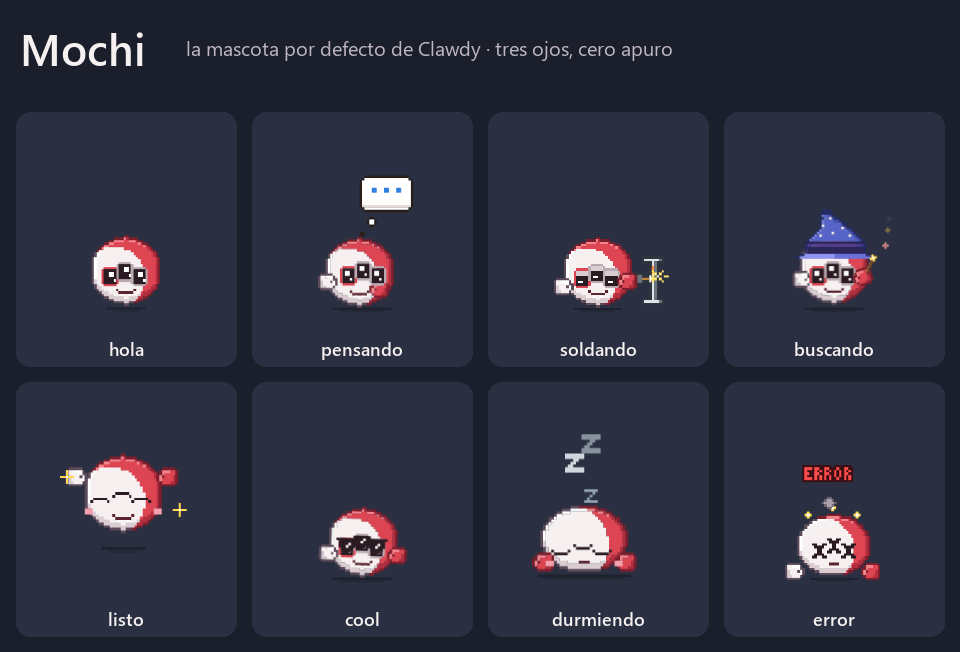

# Mochi, the default pet

Mochi is Clawdy's own character. It is the pet of every agent that has no art set of its own (Kiro, OpenCode, Antigravity and any new agent). Claude keeps Clawd the crab and Codex keeps its cloud. The art rules are in [the pet art bible](pet-art-bible.md); this sheet covers who Mochi is, so new art, poses and copy stay in character.

## At a glance

| | |
|---|---|
| Name | **Mochi**, for its round, soft body, like the Japanese sweet |
| Tagline | *tres ojos, cero apuro* (three eyes, no rush) |
| Origin | The brand's monster emblem on Sammy's hoodie, redrawn to be cute: the round red-and-white body and the cluster of eyes stay, the scary teeth go |
| Look | A round ball, white on the left with a soft cherry crescent on the right. Three big ring eyes in one touching arched row, a small smile with two baby fangs, blush, and floating mittens (white left, red right). |
| Files | `desktop/renderer/assets/monster/monster-<state>-v2.svg`, generated by `tools/monster_pixel.py` |

## Personality

- **Attentive.** The three eyes watch the code, the terminal and your next prompt at once. Mochi keeps its eyes on you when it is your turn (`waiting_reply`) and raises a hand when it needs you (`alert`).
- **Calm.** It never panics. Errors make it collapse with X eyes and a little smoke, not scream. It dozes off when the battery runs low.
- **Proud of real work.** When it builds, it welds steel; it does not stack toys. When it searches, it puts on a wizard hat as wide as its head.
- **A little clumsy.** The hat slips (`hat_mishap`), and it gets dizzy when you shake it. It laughs it off.
- **Warm.** It blushes when it is happy and celebrates the end of a turn with two hops.

## Voice

When Mochi "speaks" (tooltips, notices, README), its voice is:
- short, friendly and calm, in the user's language (Spanish in the app);
- in the first person only when the copy is about Mochi itself; tool and agent messages stay neutral;
- never alarming, sarcastic or childish.

| Do | Don't |
|---|---|
| "Mochi · Clic para ver actividad · Arrastra para mover" | "¡¡ERROR CRÍTICO!!" |
| "Mochi está esperando tu respuesta" | "Oye, ¿sigues ahí? Me aburro" |

## In the app

- **Window label:** the label under the pet keeps naming the agent (for example "Kiro"), because the label says which agent the pet works for.
- **Tooltip:** the pet's tooltip introduces Mochi: `Mochi · Clic para ver actividad · Arrastra para mover` (`desktop/renderer/renderer.js`).
- **Size:** the art is drawn on the shared 30 px body box, and the pet window shows Mochi at 80 % (`scale: 0.8` in `desktop/renderer/style.css`), so it weighs about the same as the crab.
- **Presentation sheet:** `assets/readme/mochi-sheet.png`, generated from the real animation files by `python tools/mochi_sheet.py`.

## Keep it in character

- Keep three eyes in one touching row when they are open. When they are closed, spread them apart.
- Keep the white-left / red-right split and the mittens on every pose.
- Give a new state an emotion from the personality above. If a state needs a prop, the prop is real and sized for the head (see the art bible).
